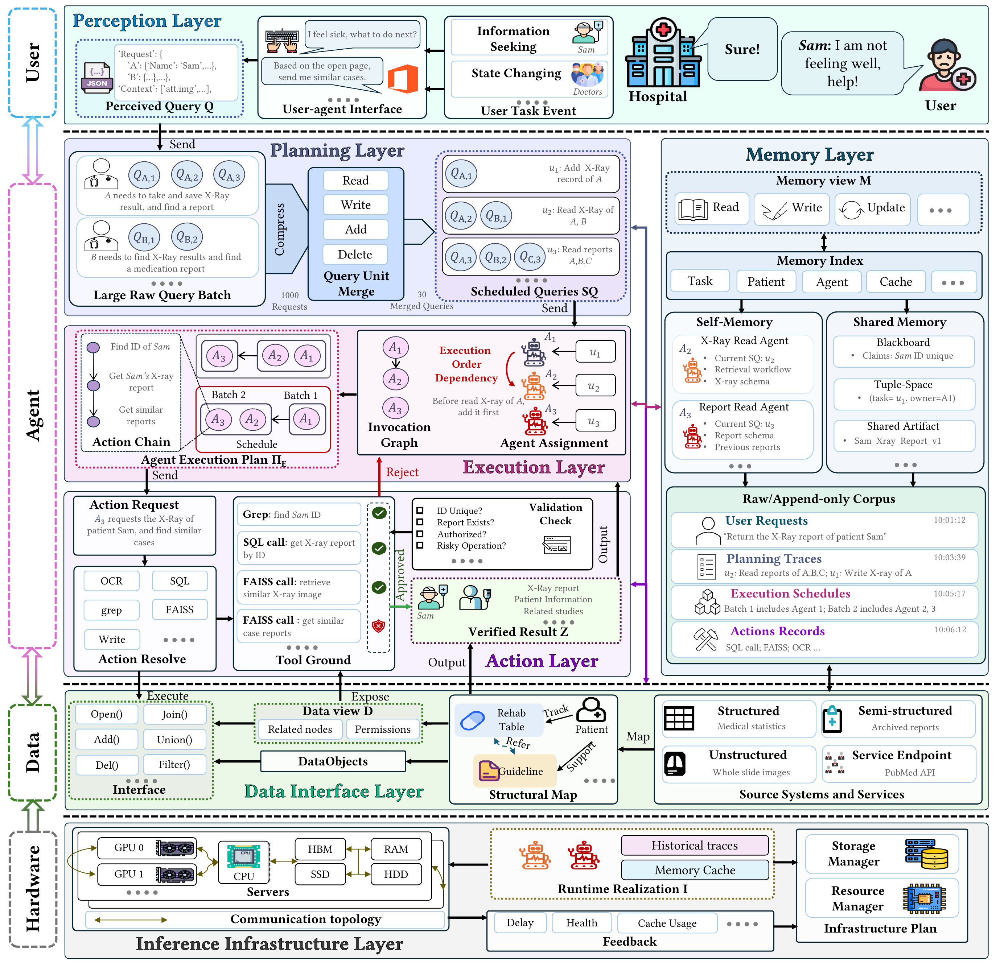

<h1 align="center">🗃️ Awesome Database for Multi-Agent System Papers</h1>

<p align="center">
  <strong>Data management, data preparation, and data analysis for multi-agent collaboration works.</strong>
</p>

<p align="center">
  <a href="#planning"></a>
  <a href="#execution"></a>
  <a href="#action"></a>
  <br>
  <a href="#memory"></a>
  <a href="#data-interface"></a>
  <a href="#inference-infrastructure"></a>
</p>

> [!NOTE]
> A topic guide and paper list on **Database for Multi-Agent Systems (DB for MAS)**. The organizing framework follows our paper, *Agent-Centric Data System: Architecture, Literature, and Challenges*.
>
> For the complementary direction, see [**Multi-Agent Systems for Database (MAS for DB)**](https://github.com/DAISYzxy/awesome-multi-agent-systems-for-database): how collaborating agents perform data management, data preparation, and data analysis tasks.

## 📑 Contents

- [Introduction](#introduction)
- [Architecture and Topic Taxonomy](#architecture)
  - [Topic Classification Table](#topic-taxonomy)
- [Paper List](#paper-list)
  - [Planning](#planning)
  - [Execution](#execution)
  - [Action](#action)
  - [Memory](#memory)
  - [Data Interface](#data-interface)
  - [Inference Infrastructure](#inference-infrastructure)
- [Citations](#citations)
  - [Cite This List](#cite-this-list)

<a id="introduction"></a>

## 🎯 Introduction

Multi-agent systems bring together agents that share information, coordinate tasks, invoke tools, and build on one another's results. Their collaboration depends on the data exchanged and retained throughout a workflow: observations, task descriptions, messages, intermediate results, shared memory, and execution records.

**Database for Multi-Agent Systems** explores how database and data-system techniques can improve the efficiency, correctness, and reliability of this collaboration. We organize the topic around three complementary perspectives: **data management**, **data preparation**, and **data analysis**.

This repository provides an introduction to the topic and a reading list organized by the functional layers of the **Agent-Centric Data System (ACDS)** architecture. The layer definitions come from the paper. The [topic classification table](#topic-taxonomy) maps the DB for MAS topics to these layers and the three data perspectives, and defines where papers will be listed.

<a id="architecture"></a>

## 🧭 Architecture and Topic Taxonomy

<p align="center">
  <a href="assets/acds-architecture.png">
    
  </a>
</p>

<p align="center">
  <em>Figure 1 from Agent-Centric Data System: Architecture, Literature, and Challenges.</em><br>
  <sub>Click the figure to view it at full resolution.</sub>
</p>

**Perception → Planning → Execution → Action** forms the main task flow. **Memory**, **Data Interface**, and **Inference Infrastructure** support that flow across steps and agents.

<a id="topic-taxonomy"></a>

### Topic Taxonomy

The table below defines the categories used by the paper list: **Layer → Data Management / Data Preparation / Data Analysis → Topic**. 

| Layer | Data Management | Data Preparation | Data Analysis |
| --- | --- | --- | --- |
| **[Planning](#planning)** | Task Decomposition and Sharing |  Dependency Construction  | Task Reuse Analysis |
| **[Execution](#execution)** | (1) Agent Assignment<br>(2) Workflow Optimization | Agent Role Definition | (1) Cost, Quality, Efficiency Estimation<br>(2) Error Propagation Analysis |
| **[Action](#action)** | (1) Tool Invocation<br>(2) Transaction Management | (1) Tool Grounding<br>(2) Parameter Binding | Action Validation and Effect Analysis |
| **[Memory](#memory)** | (1) Shared Memory and State Management<br>(2) Semantic Caching | (1) Context Compression<br>(2) Log Structuring | Memory Consistency and Utility Analysis |
| **[Data Interface](#data-interface)** | Data View and Access Management | (1) DataObject Description Construction<br>(2) Cross-source Object Resolution | Data View Validity/ Access Workload Analysis |
| **[Inference Infrastructure](#inference-infrastructure)** | Inference Scheduling and Runtime State Management | KV State Alignment and Encoding | Runtime Cost and Reuse Benefit Analysis |

<a id="paper-list"></a>

## 📚 Paper List

The sections below follow the [classification table](#topic-taxonomy).

> **Cross-layer optimization.** Many works optimize across multiple layers: the optimization target and the layer implementing the optimization need not be the same. For example, [Helium](https://arxiv.org/html/2603.16104v1) targets efficient LLM serving, with KV cache management and reuse as central concerns, while also batching queries and optimizing logical workflows through common-subgraph merging and reuse analysis. A paper may therefore appear under multiple layers.


<a id="planning"></a>

### Planning Layer: Manage, Prepare, Analyze the Query/Task

1. **Efficient LLM Serving for Agentic Workflows: A Data Systems Perspective (Helium).** [](https://doi.org/10.1145/3802046)
2. **Supporting Our AI Overlords: Redesigning Data Systems to be Agent-First.** [](https://www.vldb.org/cidrdb/papers/2026/p32-liu.pdf)
3. **SagaLLM: Context Management, Validation, and Transaction Guarantees for Multi-Agent LLM Planning.** [](https://www.vldb.org/pvldb/vol18/p4874-chang.pdf)
4. **A Demonstration of QueryArtisan: Real-Time Data Lake Analysis via Dynamically Generated Data Manipulation Code.** [](https://www.vldb.org/pvldb/vol18/p5263-tang.pdf)
5. **AllHands: Ask Me Anything on Large-scale Verbatim Feedback via Large Language Models.** [](https://www.microsoft.com/en-us/research/publication/allhands-ask-me-anything-on-large-scale-verbatim-feedback-via-large-language-models/)
6. **Batch Query Processing and Optimization for Agentic Workflows (Halo).** [](https://arxiv.org/abs/2509.02121)

<a id="execution"></a>

### Execution Layer: Manage, Prepare, Analyze the Agent

1. **DeepEye: A Steerable Self-driving Data Agent System.** [](https://arxiv.org/pdf/2603.28889)
2. **MultiVis-Agent: A Multi-Agent Framework with Logic Rules for Reliable and Comprehensive Cross-Modal Data Visualization.** [](https://arxiv.org/pdf/2601.18320)
3. **Rethinking Query Optimization for Multi-Agent Systems.** [](https://www.vldb.org/pvldb/vol20/p46-kaoudi.pdf)
4. **SpatialSQL: A Multi-Agent System for Interactive and Observable Spatial Text-to-SQL.** [](https://www.vldb.org/pvldb/vol19/p4522-tong.pdf)
5. **OpenSearch-SQL: Enhancing Text-to-SQL with Dynamic Few-shot and Consistency Alignment.** [](https://arxiv.org/pdf/2502.14913)
6. **SQL-Factory: A Multi-Agent Framework for High-Quality and Large-Scale SQL Generation.** [](https://www.vldb.org/pvldb/vol19/p292-gao.pdf)
7. **DataLab: A Unified Platform for LLM-Powered Business Intelligence.** [](https://arxiv.org/html/2412.02205v3)
8. **AutoTQA: Towards Autonomous Tabular Question Answering through Multi-Agent Large Language Models.** [](https://www.vldb.org/pvldb/vol17/p3920-zhu.pdf)
9. **Demonstration of DB-GPT: Next Generation Data Interaction System Empowered by Large Language Models.** [](https://www.vldb.org/pvldb/vol17/p4365-chen.pdf)


<a id="action"></a>

### Action Layer: Manage, Prepare, Analyze the Tool
1. **MultiVis-Agent: A Multi-Agent Framework with Logic Rules for Reliable and Comprehensive Cross-Modal Data Visualization.** [](https://arxiv.org/html/2601.18320v1)
2. **DeepEye: A Steerable Self-driving Data Agent System.** [](https://arxiv.org/html/2603.28889v1)
3. **SagaLLM: Context Management, Validation, and Transaction Guarantees for Multi-Agent LLM Planning.** [](https://www.vldb.org/pvldb/vol18/p4874-chang.pdf)


<a id="memory"></a>

### Memory Layer: Manage, Prepare, Analyze Memory

1. **Rethinking Query Optimization for Multi-Agent Systems.** [](https://www.vldb.org/pvldb/vol20/p46-kaoudi.pdf)
2. **DataLab: A Unified Platform for LLM-Powered Business Intelligence.** [](https://arxiv.org/html/2412.02205v3)
3. **SagaLLM: Context Management, Validation, and Transaction Guarantees for Multi-Agent LLM Planning.** [](https://www.vldb.org/pvldb/vol18/p4874-chang.pdf)
4. **Workload-Aware Caching for Multi-Agent Systems.** [](https://arxiv.org/abs/2607.20495)
5. **Pancake: Hierarchical Memory System for Multi-Agent LLM Serving.** [](https://arxiv.org/abs/2602.21477)
6. **MemOS: A Memory OS for AI System.** [](https://arxiv.org/abs/2507.03724)

<a id="data-interface"></a>

### Data Interface Layer: Manage, Prepare, Analyze the Interface

1. **Supporting Our AI Overlords: Redesigning Data Systems to be Agent-First.** [](https://www.cidrdb.org/cidr2026/papers/p32-liu.pdf)


<a id="inference-infrastructure"></a>
### Inference Infrastructure Layer: Manage, Prepare, Analyze the Inference Infrastructure

1. **Efficient LLM Serving for Agentic Workflows: A Data Systems Perspective (Helium).** [](https://arxiv.org/html/2603.16104v1)
2. **Mil: Cost-guided Minimum Makespan Scheduling for Applications of Multiple LLMs.** [](https://www.vldb.org/pvldb/vol19/p1893-fang.pdf)
3. **HEXGEN-FLOW: Optimizing LLM Inference Request Scheduling for Agentic Text-to-SQL.** [](https://arxiv.org/html/2505.05286v3)
4. **Agentix: An Efficient Serving Engine for LLM Agents as General Programs.** [](https://www.usenix.org/system/files/nsdi26-luo.pdf)
5. **TOPAS: Workflow-Aware Prefix-State Scheduling for Multi-Agent LLM Serving.** [](https://arxiv.org/html/2608.25523v1)
6. **TokenDance: Scaling Multi-Agent LLM Serving via Collective KV Cache Sharing.** [](https://arxiv.org/html/2604.03143v1)

## Citation

If you find this resource useful in your research, please cite it as follows:

**BibTeX:**

```bibtex
@misc{zhu2026databasemultiagent,
  author       = {Xinyi Zhu, Wenxin Zhao, Liping Wang},
  title        = {{Awesome Database for Multi-Agent System Papers}},
  year         = {2026},
  publisher    = {GitHub},
  howpublished = {\url{https://github.com/DAISYzxy/awesome-database-for-multi-agent-systems}},
  note         = {Maintained by DAISYzxy}
}
```
